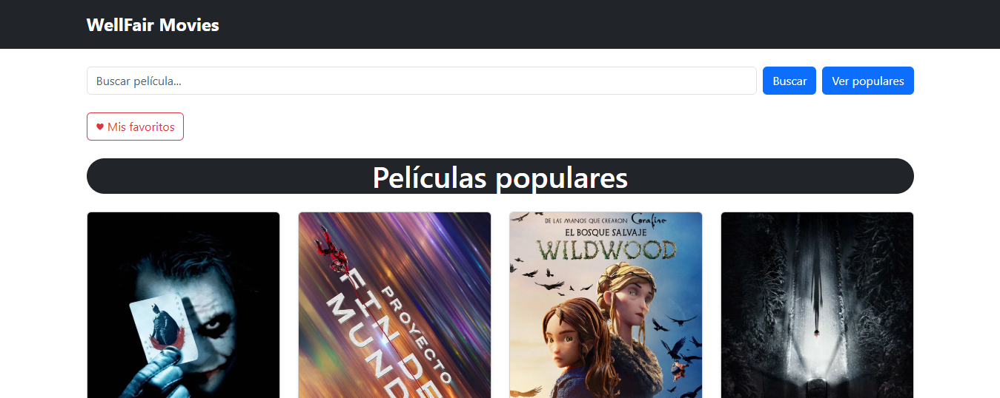
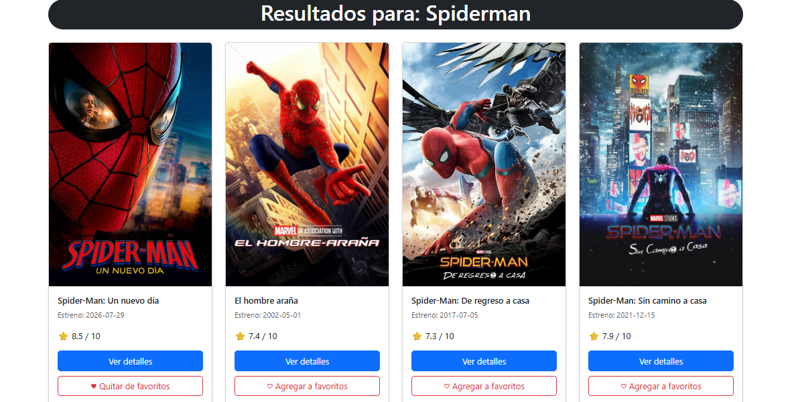
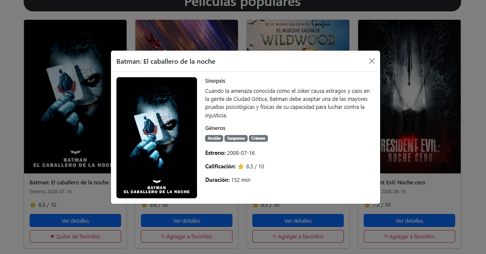
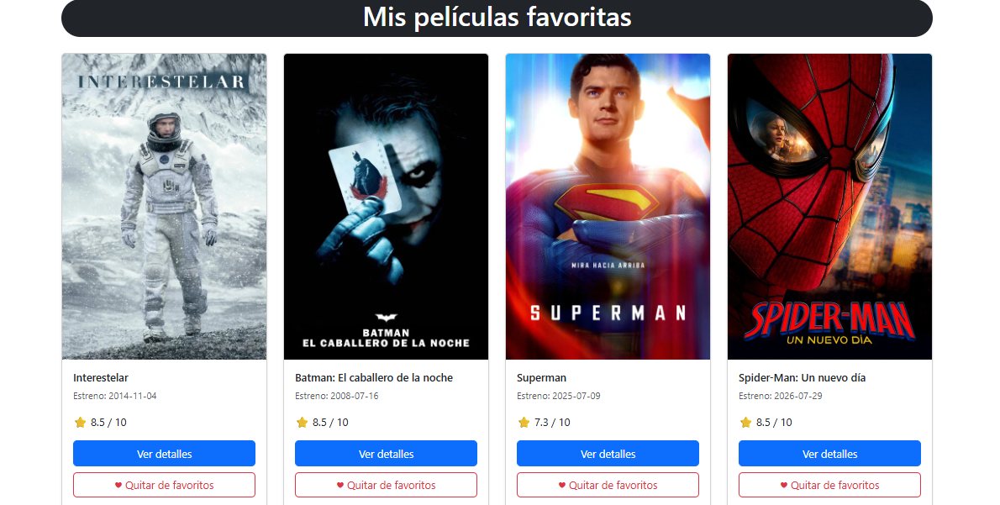

# WELLFAIR MOVIES

Aplicación web para explorar películas utilizando información de The Movie Database (TMDB).
Desarrollada como prueba técnica Full Stack, con Angular para la interfaz de usuario y Spring Boot como backend encargado de comunicarse con TMDB.

## Funcionalidades

- Visualización de películas populares con póster, título, fecha de estreno y calificación.
- Búsqueda de películas por título.
- Consulta de detalles en un modal: sinopsis, géneros, duración, fecha de estreno y calificación.
- Interfaz responsive para computadoras, tabletas y dispositivos móviles.
- Indicadores de carga y mensajes de error.
- Manejo de búsquedas sin resultados.
- Imagen alternativa cuando una película no tiene póster.
- Información solicitada en español de México cuando la traducción está disponible en TMDB.
- Favoritos: Permite agregar y eliminar películas, consultarlas en una vista específica y conservarlas mediante localStorage

## Capturas de pantalla

**Página principal:**
Visualización de películas populares con información obtenida de TMDB.


**Búsqueda de películas:**
Búsqueda de películas por título mediante nuestra API REST.


**Detalles de película:**
Ventana modal con sinopsis, géneros, calificación, fecha de estreno y duración.


**Películas Favoritas:**
Visualización de películas favoritas guardadas por el usuario.


## Tecnologías utilizadas

**Frontend**

- Angular y TypeScript.
- Bootstrap 5 para el diseño responsive y los modales.
- Angular HttpClient para las solicitudes al backend.
- RxJS y Angular Signals para manejar solicitudes y estados de la interfaz.

**Backend**

- Java y Spring Boot.
- Spring Web MVC para los endpoints REST.
- Spring RestClient para consumir la API externa.
- Maven para gestionar las dependencias.

**API externa**

- TMDB API v3.

## Requisitos previos

- Node.js y npm compatibles con la versión de Angular del proyecto (v22.2.0).
- JDK 25, utilizado durante el desarrollo.
- Git.
- Una cuenta de TMDB con acceso a su API.

## Instalación

Los siguientes comandos están preparados para Windows con PowerShell.

**Clonar el repositorio:**

```bash
git clone https://github.com/FaridCuxim22/wellfair-movies.git
cd wellfair-movies
```

**Instalar las dependencias del frontend:**

```powershell
cd frontend
npm.cmd ci
```

**El backend utiliza Maven Wrapper, por lo que no requiere instalar Maven globalmente.**

## Configuración de TMDB

1. Crear una cuenta en [TMDB](https://www.themoviedb.org/).
2. Acceder a la configuración de API de la cuenta.
3. Obtener el **API Read Access Token**.
4. Configurar la variable de entorno `TMDB_READ_TOKEN` antes de iniciar el backend.

En `backend/src/main/resources/application.properties` se utiliza:

```properties
spring.application.name=backend
tmdb.api.token=${TMDB_READ_TOKEN}
```

Para configurar la variable temporalmente desde PowerShell, dentro de la terminal donde se ejecutará el backend:

```powershell
$secureToken = Read-Host "Token de TMDB" -AsSecureString
$env:TMDB_READ_TOKEN = ([System.Net.NetworkCredential]::new("", $secureToken).Password).Trim()
Remove-Variable secureToken
```

Estos comandos solicitan el token sin mostrarlo en la terminal, configuran la variable de entorno TMDB_READ_TOKEN y eliminan la variable temporal utilizada durante el proceso. La variable de entorno estará disponible durante la sesión actual de PowerShell y para Spring Boot iniciado desde ella.

**Importante:** Nunca colocar el token directamente en archivos versionados ni publicarlo en el repositorio.

## Ejecución del proyecto

Se necesitan dos terminales.

### Backend

Desde la carpeta `backend`, con `TMDB_READ_TOKEN` configurado:

```powershell
.\mvnw.cmd spring-boot:run
```

El backend estará disponible en:

`http://localhost:8080`

### Frontend

Desde la carpeta `frontend`:

```powershell
npx.cmd ng serve --proxy-config src/proxy.conf.json
```

Abrir la aplicación en:

`http://localhost:4200`

El proyecto utiliza un proxy de desarrollo para enviar las solicitudes `/api` de Angular a Spring Boot.

## Compilación del frontend

Desde la carpeta `frontend`:

```powershell
npm.cmd run build
```

Angular genera los archivos optimizados dentro de `dist/`.

**Nota:** el proxy utilizado por `ng serve` es exclusivo del desarrollo. Para desplegar la aplicación, se debe configurar la comunicación entre frontend y backend en el entorno de producción.

## Créditos

Los datos e imágenes de películas provienen de [The Movie Database (TMDB)](https://www.themoviedb.org/).

_This product uses the TMDB API but is not endorsed or certified by TMDB._

Proyecto desarrollado con fines de **evaluación técnica.**
